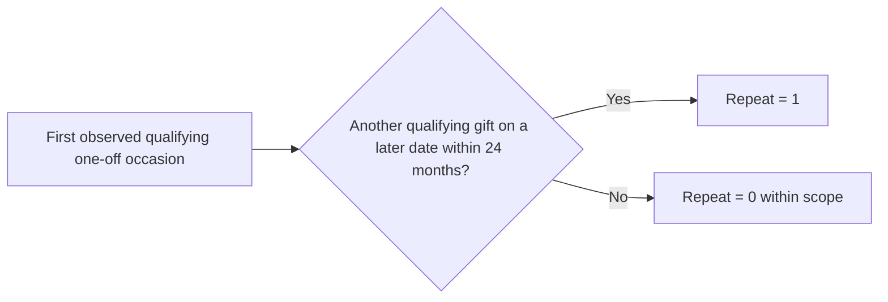

# 01 — Business Understanding

> **Business question:** How can World Vision Australia use first-gift information to make better-informed one-off supporter retention decisions?

This MIS779 client-based capstone investigated whether existing donation information could help WVA identify **who** represents higher relative repeat-giving opportunity, **what** early context matters and **when** supporters have historically returned.

## 1. The business challenge

A one-off donation does not create a continuing commitment. WVA therefore needs evidence to understand progression to another gift, without assuming that everyone who does not repeat has disengaged: supporters may contribute through other programmes. Some apparently new one-off donors also have prior WVA relationships.

The objective was to **inform retention decisions**, not to prove an intervention's effectiveness or build a deployed campaign system.

## 2. Decisions the analysis was designed to inform

| Decision question | Evidence needed |
|---|---|
| **Who** warrants closer attention? | Repeat-giving patterns and the ability to rank Mass supporters by relative propensity |
| **What** context differentiates supporters? | First-gift amount, product, acquisition channel and previous WVA relationship |
| **When** might re-engagement be tested? | Historical timing of second qualifying gifts |
| **Which** journey merits investigation? | Channel differences, including comparisons within similar products |

These decisions could support fundraising/retention, CRM and analytics functions; operational ownership was not established by the analysis.

## 3. Defining a meaningful outcome

**Repeat giving** means **another qualifying one-off donation on a later date, within 24 months of the first observed qualifying giving occasion**. Same-day transactions form a single giving occasion. BounceBack-coded giving and supporters active in ongoing commitments at the first occasion are excluded from the eligible one-off analysis; eligible former ongoing supporters remain. Every evaluated supporter needs a complete 24-month follow-up window.

**Interpretation:** “First observed” is defined by the supplied history, not necessarily the supporter's first-ever WVA interaction. The outcome does not include regular-giving conversion or all forms of relationship value.

## 4. Analytical approach and success

The project follows **source assessment → supporter-level preparation → descriptive findings → predictive evaluation → integrated recommendations**. Descriptive analysis examines eligible recent supporters; predictive modelling concentrates on the WVA-classified **Mass** acquisition group, with only information available by the end of the first giving occasion.

Success has two distinct levels:

| Completed analytical assessment | Future business validation |
|---|---|
| Clear cohort and outcome; explainable descriptive comparisons; ROC-AUC and ranking Lift@K/Capture@K | Whether an approved retention activity generates **incremental** repeat conversion, donation value and acceptable contact costs/experience |

The academic project completed the **analytical assessment and recommendations**, not operational intervention testing. Historical correlation or predictive lift is not causal campaign impact.

**Next:** The business questions require consistent definitions, quality checks and supporter-level records.

[Next: Data Understanding & Preparation →](02-data-understanding-and-preparation.md)
