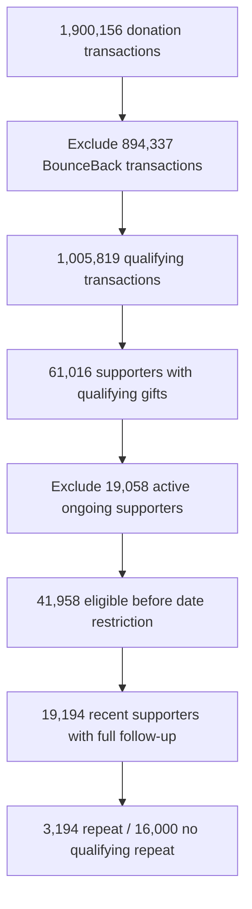

# 02 — Data Understanding & Preparation

> **Data question:** How can WVA's different transaction and engagement records become a reliable supporter-level dataset for a 24-month repeat outcome?

## 1. Six sources, different roles

| Source | Use in the analysis |
|---|---|
| One-Off Donations | Gift date, amount, product, channel, giving occasions and repeat outcome |
| Supporter Demographics | WVA join history and supporter context |
| Ongoing Commitments | Determine whether ongoing giving was active or had ended at first gift |
| Communications Sent | Examine availability of historical outbound-contact records |
| Communications Clicked | Assess engagement coverage; not assumed complete for later cohorts |
| Portal Engagement | Assess availability of digital-engagement history |

**Not every reviewed source became a final model feature.** Different recording periods and levels of detail meant that absence of a communication record could not safely be interpreted as absence of real engagement.

## 2. Quality checks that changed interpretation

| Issue checked | Treatment or finding | Why it mattered |
|---|---|---|
| IDs, duplicate keys and dates | Standardised identifiers and converted date/amount fields; tested duplicate records | Prevent incorrect joins, ordering and supporter counts |
| Missing and implausible demographics | Invalid ages were set to missing; coverage reviewed | Avoid misleading segmentation |
| Geographic variations | Standardised country/state labels; some irregular records manually reviewed in private work | Avoid fragmented categories; residual quality uncertainty remains |
| Ongoing-commitment dates | Seven inconsistent start/end or closure sequences flagged | Active/former eligibility depends on reliable dates |
| Uneven activity coverage | Click data covered 2018–2019 in the recorded extract | Cannot treat missing later clicks as evidence of no engagement |

Data-quality checks improve the defensibility of the *available extract*; they cannot prove historical completeness.

## 3. Build one record per eligible supporter

1. **Qualify donations:** exclude BounceBack codes `BB`, `BB COMSPON` and `BB COST REC` as out of scope—not invalid transactions.
2. **Find the first observed date:** group all qualifying same-day transactions into one initial giving occasion; sum amounts. Choose the primary product/context from the largest first-day transaction, with multiple-channel handling where applicable.
3. **Classify ongoing giving:** exclude supporters whose ongoing commitment was active at that first occasion; retain eligible former ongoing supporters.
4. **Define repeat:** assign `1` for a later qualifying one-off gift within 24 months, otherwise `0` only when a full 24-month window is observable.
5. **Anchor predictors:** use first-gift details and historical relationship information available by the prediction point, not later behaviour.

These rules matter: **2,321** descriptive-cohort supporters had multiple qualifying transactions on their first giving date, so treating same-day transactions as separate gifts would overstate repeats.

## 4. From transactions to the descriptive cohort

The descriptive cohort covers first observed qualifying occasions **17 March 2021–17 March 2024**, with observations through **17 March 2026**. Its 24-month repeat rate was **3,194 / 19,194 = 16.6%**. Its prepared table had 19,194 unique supporter records in the saved notebook checks.

## 5. Keep the descriptive and predictive populations separate

| Population | First-gift period | Supporters | Purpose |
|---|---|---:|---|
| **Descriptive** | 17 Mar 2021–17 Mar 2024 | **19,194** | Describe repeat patterns (16.6% baseline) |
| **Mass modelling: development** | 2019–2021 | 7,255 | Train candidate models |
| **Mass modelling: validation** | 2022 | 6,772 | Compare and select configurations |
| **Mass modelling: final test** | 2023–17 Mar 2024 | **6,741** | Retrospective ranking evaluation (13.8% baseline) |
| **Total Mass modelling** | 2019–17 Mar 2024 | **20,768** | Separate historical analytical population |

The final selected model was fitted on **14,027 Mass supporters from 2019–2022** (development plus validation years). The two baselines describe **different populations** and must not be interchanged.

**Limitations:** Historical extract completeness is unverified; “first observed” need not mean first ever. First-gift-year splits alone do not prove that 24-month outcomes were available at a hypothetical deployment date. This is retrospective cohort analysis, not a full point-in-time simulation.

**Next:** With a consistent supporter-level outcome, the analysis can examine which first-gift contexts differ descriptively.

[← Business Understanding](01-business-understanding.md) · [Next: Exploratory Analysis →](03-exploratory-analysis-and-insights.md)
