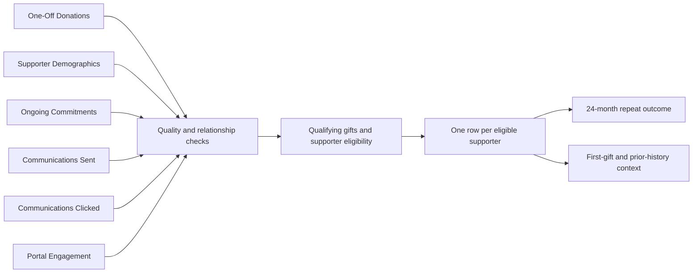
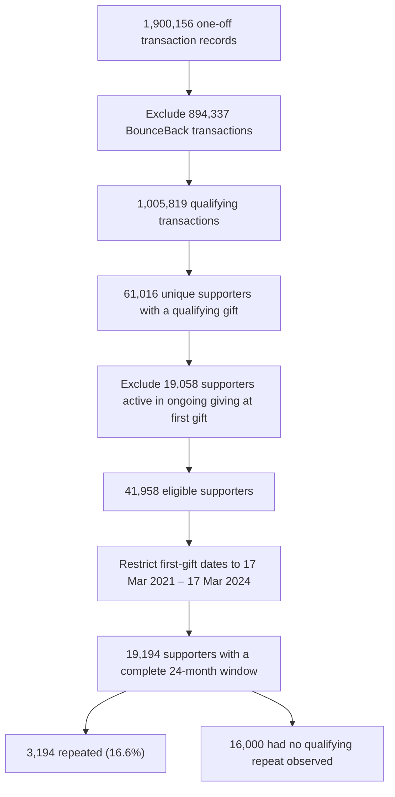

# 02 — Data Understanding & Preparation

## World Vision Australia — Donor Retention Analytics

> **Data question:** How can six datasets with different levels of detail and historical coverage be converted into a consistent, supporter-level view of repeat one-off giving?

This stage documents the checks, business rules and transformations used to construct the analytical populations. **The objective was decision-ready data, not simply a larger combined table.**

---

## 1. Understanding the Data Landscape

The project reviewed six WVA-supplied datasets, linked through a de-identified supporter identifier. They describe different activities and do not all represent one row per supporter.

| Data source | Information provided | Analytical purpose |
|---|---|---|
| **One-Off Donations** | Gift dates, paid amounts, products and attribution channels | Define qualifying giving occasions, first-gift context and repeat outcomes |
| **Supporter Demographics** | Supporter details, recorded WVA join date and segment/location attributes | Describe supporter context and historical relationship |
| **Ongoing Commitments** | Commitment start, end and closure information | Distinguish active ongoing supporters from eligible former ongoing supporters |
| **Communications Sent** | Recorded communication methods and send dates | Assess availability of prior contact history |
| **Communications Clicked** | Recorded clicks and dates | Assess whether engagement evidence is usable across the relevant periods |
| **Portal Engagement** | Recorded portal access and activity | Review availability of digital-engagement history |

**Important distinction:** The six sources were assessed for relevance and reliability; this does **not** mean every source contributed features to the final predictive model.

---

## 2. Data Quality: Checks, Findings and Treatment

The notebook inspected source sizes, date ranges, missingness, identifier uniqueness, cross-file overlap and business-rule consistency before creating cohorts.

| Quality check / issue | Why it matters | Recorded treatment or finding | Remaining limitation |
|---|---|---|---|
| **Identifiers and duplicates** | Incorrect joins can multiply donations or supporters | IDs were standardised; the saved checks found no exact duplicate rows or duplicate primary keys in the fields tested | Uniqueness checks cannot establish that the extract contains every historical record |
| **Date and number formats** | Text dates prevent reliable sequencing; inconsistent numeric formats undermine calculations | Relevant dates and numeric fields were converted; blank text was standardised as missing | Successful conversion does not guarantee that every recorded value reflects the real-world event |
| **Missing fields** | Missing attributes can weaken segmentation | Core gift identifiers, dates, amounts, channels and products were complete in the recorded checks; age had substantial missingness | Missing optional activity information is not proof of inactivity |
| **Unusual ages** | Impossible values distort demographic analysis | Negative ages and ages above 100 were set to missing; ages below 18 were not automatically discarded | Age-based interpretations remain sensitive to missing data and recording quality |
| **Geographic inconsistencies** | Multiple labels can split one location across categories | Country and Australian state labels were standardised; selected irregular addresses were checked against available location details | Not all address quality can be verified from the extract alone |
| **Ongoing-commitment dates** | Incorrect date ordering can misclassify an active relationship | Seven records with an end/closure date before the start were identified and flagged for cautious handling | Uncertain historical commitment dates remain a classification risk |
| **Uneven source coverage** | Missing interaction history can be confused with no interaction | Source date ranges and supporter overlap were examined before feature selection | Click records covered **2018–2019** in the saved extract, making them unsuitable as a complete engagement history for later cohorts |

**Illustrative coverage check:** One-off donations ran from **1 July 1985 to 17 March 2026** in the notebook; Communications Clicked ran from **19 March 2018 to 6 October 2019**. These differences matter more than treating every blank engagement field as a zero.

---

## 3. Preparing a Supporter-Level Dataset

The analytical starting point is the **first observed qualifying one-off giving occasion**. It is not necessarily a supporter's first-ever relationship with WVA.

| Preparation rule | Implementation and reason |
|---|---|
| **Exclude BounceBack** | Remove transactions coded `BB`, `BB COMSPON` or `BB COST REC` from the *qualifying one-off* definition. This is a business-scope exclusion, **not** deletion of erroneous data. |
| **Identify first qualifying date** | Find the earliest qualifying donation date for each supporter in the supplied history. |
| **Combine same-day gifts** | Treat all qualifying transactions from the supporter on that date as **one giving occasion**, avoiding false same-day repeats. |
| **Construct first-gift context** | Sum first-day amounts; select the product and associated acquisition context from the largest first-day transaction. Label channel `MULTIPLE` when several channels occur that day. |
| **Classify ongoing relationships** | Compare commitment dates with the first qualifying date; exclude supporters with an **active** ongoing commitment, while retaining otherwise eligible **former** ongoing supporters. |
| **Assign the repeat outcome** | `Repeat_Donor = 1` only if another qualifying one-off gift occurs on a **later date** within 24 months; otherwise `0` for supporters with a complete observable window. |
| **Protect prediction timing** | Anchor potential predictors at the end of the first giving occasion. Do not use later gifts, later communication/engagement activity or outcome dates as predictors. |

The same-day rule was material, not cosmetic: **2,321 of 19,194** descriptive-cohort supporters had multiple qualifying transactions on their first giving date; **1,582** had multiple first-day product categories. Selecting one arbitrary transaction would misstate the initial giving context.

The notebook's final descriptive supporter-level check recorded **19,194 rows for 19,194 unique supporters**, with no duplicate supporter rows, missing first-gift dates, missing first-gift amounts, invalid first-gift amounts or missing repeat labels in that constructed table.

---

## 4. Building the Descriptive Cohort

The following flow uses the **saved notebook outputs**. Notice the change in unit from *transaction records* to *unique supporters*.

| Checkpoint | Recorded count | Unit |
|---|---:|---|
| Original one-off history | 1,900,156 | Transaction records |
| BounceBack excluded | 894,337 | Transaction records |
| Remaining qualifying gifts | 1,005,819 | Transaction records |
| Supporters with qualifying gifts | 61,016 | Unique supporters |
| Active ongoing supporters excluded | 19,058 | Unique supporters |
| Eligible before recent-period restriction | 41,958 | Unique supporters |
| **Final descriptive cohort** | **19,194** | **Unique supporters** |
| Repeat within 24 months | 3,194 | Unique supporters |
| No qualifying repeat within 24 months | 16,000 | Unique supporters |

**Observation cut-off:** 17 March 2026. The latest first-gift date eligible for a full 24-month follow-up was therefore **17 March 2024**; the descriptive cohort begins **17 March 2021**.

**Why full follow-up matters:** Someone whose first gift occurred too recently has not had the same opportunity to repeat. Including them as a non-repeat supporter would artificially depress the measured repeat rate. A `0` label here means **no qualifying repeat observed within 24 months**, not permanent disengagement or absence of other WVA support.

---

## 5. Two Different Analytical Populations

The descriptive dataset answers **what patterns occurred** in a recent eligible supporter group. Predictive modelling instead uses a **historical Mass acquisition population** to assess whether first-gift information can rank relative repeat-giving propensity. These are **not nested cohorts** and their baseline rates should not be mixed.

| Population | First-gift period | Supporters | Purpose / outcome |
|---|---|---:|---|
| **Descriptive cohort** | 17 Mar 2021 – 17 Mar 2024 | **19,194** | 3,194 repeated: **16.6%** |
| Historical **Mass** modelling population | 2019 – 17 Mar 2024 | **20,768** | Separate population for retrospective cohort evaluation |
| Model development | 2019–2021 | 7,255 | Earlier historical development data |
| Model validation | 2022 | 6,772 | Model and feature-set selection |
| Final test | 2023 – 17 Mar 2024 | **6,741** | 929 repeated: **13.8%** baseline |
| Final training (development + validation years) | 2019–2022 | **14,027** | Used for the selected final model |

The dated cohorts were separated chronologically, but **first-gift-year splitting alone does not guarantee that every 24-month label was available at a hypothetical training date**. The work should therefore be understood as **retrospective cohort evaluation**, not a fully reconstructed deployment simulation. The model design and evaluation are addressed in [Stage 4](04-predictive-modelling-and-evaluation.md).

---

## 6. Data Readiness and Interpretation Boundaries

**What the completed preparation supports:** a consistently defined qualifying first giving occasion, a 24-month repeat label, a validated descriptive supporter-level table and a separately defined historical Mass modelling population.

**What remains uncertain:**

- The first **observed** gift may not be the first gift or first relationship in WVA's complete history. Historical extract completeness was not independently established.
- Communication and portal histories have uneven coverage; absence of a record does not always mean absence of engagement.
- Some demographic/geographic and ongoing-commitment values required judgement or flags; no claim of perfect source quality is made.
- Historical Mass repeat rates changed sharply between years. Coverage, product mix and population differences require further investigation; their causes have **not** been verified.
- The original raw WVA files are unavailable for a fresh end-to-end run. Counts and checks above are drawn from the final report and saved notebook code/outputs, **not independently reproduced results**.

**Decision implication:** The constructed data is suitable for explaining the **recorded** descriptive findings and historical ranking evaluation, with explicit caveats. Any operational use would require refreshed data, extract-completeness checks, consistent eligibility rules and time-appropriate outcome labels.

---

### Next: From Prepared Data to Business Insights

[← Previous: Business Understanding](01-business-understanding.md)  
[Next: Exploratory Analysis & Business Insights →](03-exploratory-analysis-and-insights.md)
