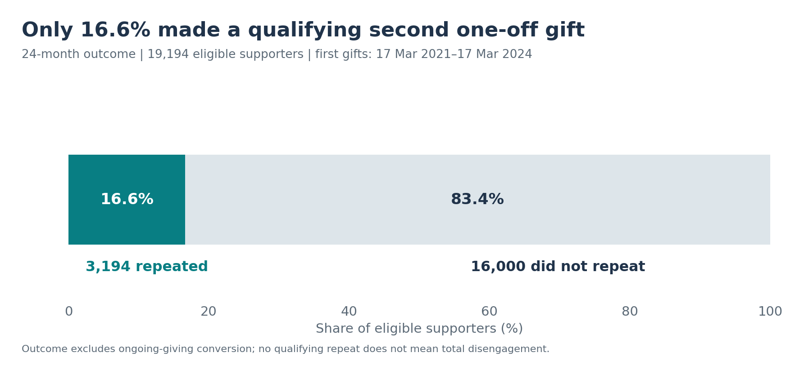
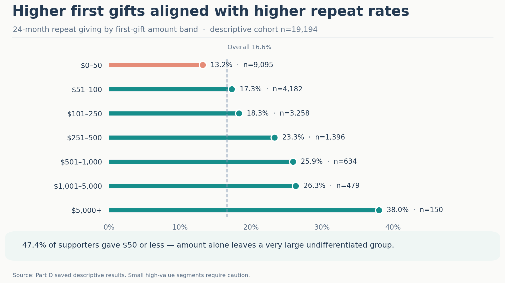
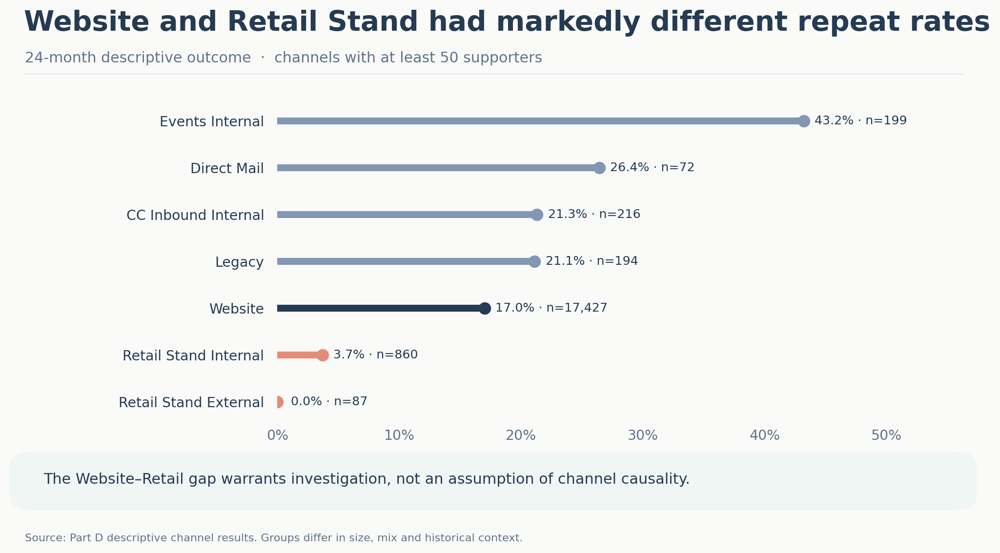
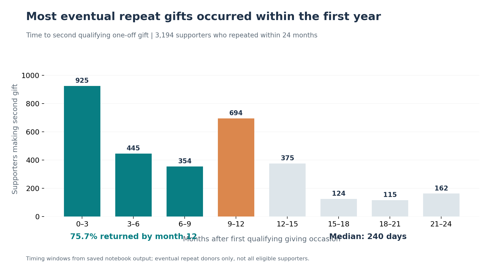

# 03 — Exploratory Analysis & Business Insights

> **Analytical question:** Which observed first-gift and relationship characteristics distinguish supporters who gave again within 24 months?

**Population:** **19,194** eligible supporters, first observed qualifying gifts **17 March 2021–17 March 2024**, complete 24-month follow-up. These are *descriptive associations*, not evidence that a characteristic causes another gift.

## 1. How common—and stable—is repeat giving?

**3,194 supporters (16.6%)** made another qualifying one-off gift; **16,000** did not record this specific outcome. Repeat rates differed by first-gift cohort: **19.6% in 2021** (n=5,465), **17.0% in 2022** (n=6,842), **13.9% in 2023** (n=6,275) and **15.5% in partial 2024** (n=612). Changing composition or coverage may contribute; the rates do not prove declining programme performance. **Implication for analysis:** later-cohort model testing matters.

## 2. Is first-gift amount enough?

Observed repeat giving generally rose with initial value: **13.2% for $0–50**, **23.3% for $251–500**, and **38.0% for gifts above $5,000** (only 150 supporters). Yet **9,095 supporters (47.4%)** gave **$50 or less**. Amount is informative, but an amount-only rule would group almost half the cohort together and miss differences within that group.

## 3. Does first-gift product add context?

| Primary first-gift product | Supporters | 24-month repeat rate |
|---|---:|---:|
| Multiplying Gift Appeal | 602 | **36.2%** |
| WV Regular Giving | 5,602 | **19.4%** |
| Emergency Relief | 5,534 | **15.3%** |
| World Vision Gifts | 5,819 | **14.0%** |
| Child Rescue | — | **10.2%** |

*Product categories reflect the primary qualifying first-day transaction, not evidence that a supporter held an active ongoing commitment. The Child Rescue group size is omitted here because it was not independently confirmed from the available summary.*

Product-level differences indicate that gift value does not fully describe the initial appeal or supporter context. They motivate evaluating product alongside amount, **not** assuming particular products cause retention.

## 4. How does acquisition channel relate to product?

**Website** represented **17,427 supporters (90.8%)** with a **17.0%** repeat rate; **Retail Stand Internal** recorded **3.7% (32/860)**. Smaller channels vary markedly and need caution. The gap also appeared *within comparable products*:

| Primary product | Website | Retail Stand Internal |
|---|---:|---:|
| WV Regular Giving | 19.9% (n=5,205) | 3.3% (n=243) |
| Child Rescue | 19.1% (n=293) | 2.9% (n=314) |
| World Vision Gifts | 14.3% (n=5,550) | 5.3% (n=207) |
| Emergency Relief | 15.1% (n=5,238) | 4.8% (n=63) |

The within-product comparison weakens a **product-mix-only** explanation. It does **not** identify the cause: acquisition intent, recording quality or subsequent contact experience might differ.

## 5. Does previous WVA relationship matter?

Two **different classifications** were analysed:

| Relationship definition | Group | Supporters | Repeat rate |
|---|---|---:|---:|
| **Ongoing commitment history** | Former ongoing | 399 | **21.3%** (85) |
| | No prior ongoing commitment | 18,795 | **16.5%** (3,109) |
| **WVA database history** | Known before first qualifying gift | 1,699 | **22.4%** (381) |
| | Joined on first-gift date | 17,136 | **16.0%** (2,747) |

*The classifications are not four mutually exclusive segments. Database join history was unknown/inconsistent for another 359 supporters; active ongoing supporters at first gift were excluded.*

Prior relationships coincide with higher observed repeat rates. Whether they provide **new predictive information after product, value and channel are combined** is a separate Stage 4 question.

## 6. When did supporters repeat?

Of the **3,194 supporters who repeated within 24 months**, **29.0%** did so by month 3, **42.9%** by month 6, **75.7%** by month 12 and **91.3%** by month 18. Median time to repeat was about **240 days**; the saved three-month distribution records **694** second gifts in months 9–12, consistent with an anniversary-period concentration.

**Denominator matters:** these timing shares describe *eventual repeat supporters*, not all 19,194 eligible supporters. They identify periods to investigate, **not** the best proven contact time.

## 7. What should predictive analysis test next?

| Descriptive signal | Reason to test it in combination |
|---|---|
| **Amount** | Associated with repeat giving, but the low-value segment is very large |
| **Product and channel** | Differentiate first-gift contexts beyond amount alone |
| **Previous relationship** | Descriptive association may or may not add independent ranking information |
| **Timing** | Addresses *when* repeat gifts occurred; distinct from predicting *who* repeats |

**Next:** Stage 4 evaluates whether these signals provide additional predictive information and whether the combined ranking is useful under limited retention capacity.

[← Data Understanding & Preparation](02-data-understanding-and-preparation.md) · [Next: Predictive Modelling & Evaluation →](04-predictive-modelling-and-evaluation.md)
