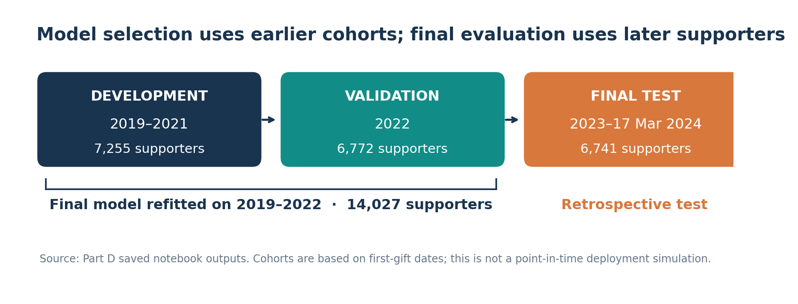
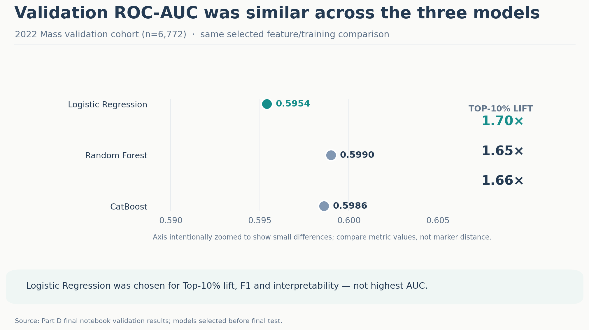
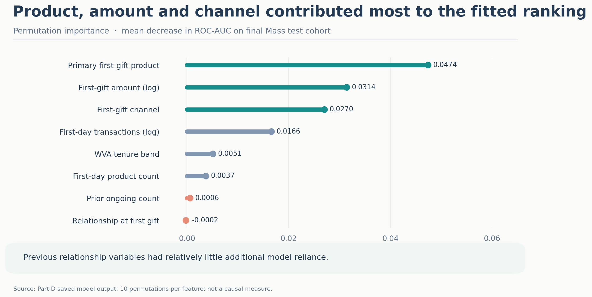
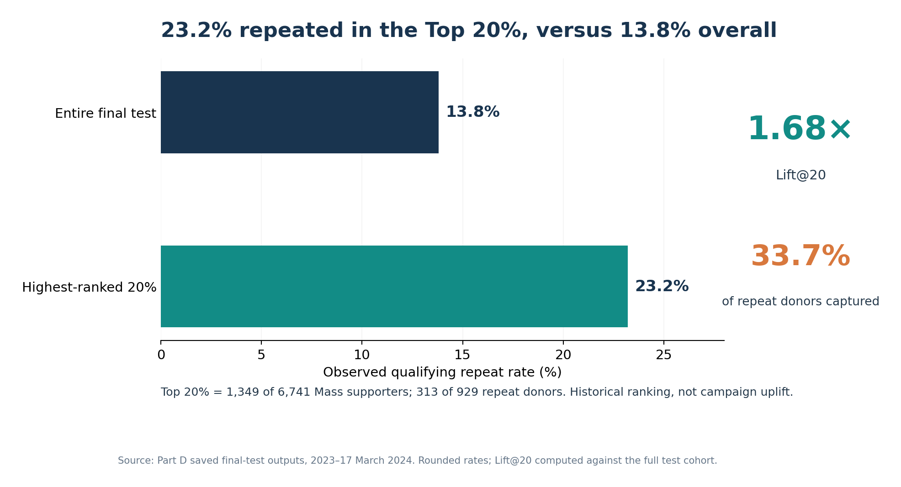

# 04 — Predictive Modelling & Evaluation

> **Analytical question:** Do the descriptive signals contribute useful information when combined—and can they support practical retention prioritisation?

## 1. Prediction and evaluation design

The target was **another qualifying one-off gift on a later date within 24 months**. Each eligible **Mass** supporter was scored at the **end of their first qualifying giving occasion**, using first-gift context and prior relationship information available then—not future donation or engagement events.

Three feature sets (first-gift only; first-gift plus WVA history; extended acquisition context) were assessed using **Logistic Regression, Random Forest and CatBoost**. The selected model uses eight first-gift/history variables, including first-day amount, transaction and product counts, primary product, channel, relationship at first gift, WVA tenure band and previous ongoing count.

| Role | First-gift period | Mass supporters |
|---|---|---:|
| Development | 2019–2021 | 7,255 |
| Validation / configuration selection | 2022 | 6,772 |
| Final training, after selection | 2019–2022 | 14,027 |
| **Retrospective final test** | **2023–17 Mar 2024** | **6,741** |

**Boundary:** This was retrospective cohort testing, not fully point-in-time deployment validation. Some training-period 24-month labels would not have been observable at a hypothetical early deployment date; the broader exploratory process also examined some outcomes overlapping the later test period.

## 2. Why Logistic Regression?

| Model, comparable 2022 validation setup | ROC-AUC | F1 | Lift@10 |
|---|---:|---:|---:|
| **Logistic Regression** | 0.5954 | **0.2823** | **1.70×** |
| Random Forest | **0.5990** | 0.2654 | 1.65× |
| CatBoost | 0.5986 | 0.2637 | 1.66× |

Logistic Regression was selected for its balance of **Top-K concentration, threshold performance and interpretability**. It did **not** have the highest validation ROC-AUC. The chosen model was then refitted on the combined 2019–2022 group and evaluated on the later Mass cohort; ranking uses predicted probabilities, not a binary label.

## 3. H1–H3: What remains informative when signals are combined?

The following are **analytical propositions, not causal or formal significance tests**. The saved final-test permutation-importance results measure how much ROC-AUC falls when each variable is shuffled; correlation between predictors limits strict claims of independent effect.

| Question | Evidence in the combined model | Conclusion |
|---|---|---|
| **H1 — Does first-gift amount matter beyond other characteristics?** | Amount permutation importance **0.0314** | Retains useful ranking information; not sufficient as a single prioritisation rule |
| **H2 — Do product and channel matter alongside amount?** | Primary product **0.0474** (highest); channel **0.0270** | Both contribute predictive information beyond amount in this fitted model |
| **H3 — Does previous WVA relationship add much?** | WVA tenure **0.0051**; prior ongoing count **0.0006**; relationship at first gift approximately **−0.0002** | Descriptive differences exist, but additional model reliance is limited after first-gift context |

A feature can be associated with repeat giving descriptively without materially improving a multivariable model. This is especially relevant for previous WVA relationship; it remains meaningful *context*, but the fitted ranking relied far more on product, amount and channel. Importance is **not causal influence**.

## 4. H4: Is ranking useful at limited capacity?

The final **6,741-supporter Mass test cohort** contained **929 repeat donors (13.8%)**. Logistic Regression achieved **ROC-AUC 0.6266**—moderate discrimination, **not** 62.66% classification accuracy. At the validation-selected threshold of 0.36, precision was 0.2448, recall 0.2271 and F1 0.2356; deterministic individual prediction is not its strength.

| Final-test selection | Supporters | Observed repeats | Repeat rate |
|---|---:|---:|---:|
| All eligible Mass test supporters | 6,741 | 929 | **13.8%** |
| **Highest-ranked 20%** | **1,349** | **313** | **23.2%** |

The top-ranked group contained **33.7% of all observed repeat donors**, achieving **Lift@20 of 1.68×** versus the test baseline. **H4 supports further investigation of relative prioritisation—not a claim that targeting generated extra donations.** No amount-only/product-only rule was tested at equal selection capacity in the published comparison.

*Top-K note:* Ceiling-based selection produced **1,349** supporters, while a separate percentile-based segmentation selected **1,348**; both recorded 313 repeaters. A future operational rule would need consistent rounding and tie handling.

## 5. Integrated predictive conclusion

Product, amount and channel offered the strongest recorded first-gift signals; previous WVA history added relatively little predictive separation. The model concentrated historical repeat donors in a smaller priority group, but moderate ROC-AUC and retrospective validation limit individual-level and future-use claims.

**Before operational adoption:** validate score stability in future cohorts, reconstruct genuinely point-in-time features and labels, compare simple prioritisation rules, and test whether additional contact **causes incremental** giving. The ranking is a **historically evaluated candidate**, not a deployed system.

**Next:** Stage 5 combines *who* the ranking identifies with *when* historical repeat giving occurred, then translates the evidence into testable recommendations.

[← Exploratory Analysis & Insights](03-exploratory-analysis-and-insights.md) · [Next: Recommendations & Business Value →](05-recommendations-and-business-value.md)
