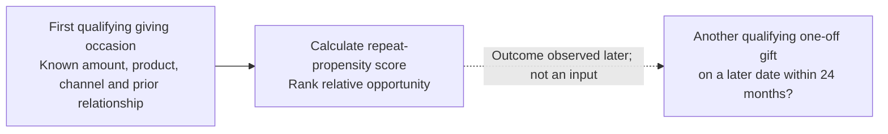

# 04 — Predictive Modelling & Evaluation
## World Vision Australia — Donor Retention Analytics

> **Business question:** Can information available at the first qualifying giving occasion help WVA rank eligible Mass supporters for limited retention attention?

Stage 3 identified descriptive differences in repeat giving. This stage tests whether first-gift context can **rank relative repeat-giving propensity**. The outcome is a later qualifying one-off gift within **24 months**; the work is a retrospective academic capstone analysis, not a deployed retention programme.

### Final-test performance at a glance

| Measure | Recorded result |
|---|---:|
| Selected model | **Logistic Regression** |
| Final Mass test cohort | **6,741 supporters** |
| Observed repeat supporters | **929 (13.8%)** |
| ROC-AUC | **0.6266** |
| Highest-ranked 20% | **1,349 supporters** |
| Repeat supporters within Top 20% | **313 (23.2%)** |
| Lift@20 / Capture@20 | **1.68× / 33.7%** |

**Key finding:** Individual discrimination was moderate, but the highest-ranked fifth contained about one-third of observed repeat donors. **This is historical concentration, not evidence that extra contact increased giving.** The **13.8%** baseline here is for the *Mass test population*; Stage 3's **16.6%** describes a separate 19,194-supporter descriptive cohort.

---

## 1. What can be predicted at the first gift?

The unit is **one eligible Mass supporter**. A score is anchored at the **end of the first qualifying giving occasion**, before any later giving or engagement outcomes are known.

Three candidate feature sets were tested: **first-gift context (5 variables)**; **first gift plus WVA relationship history (8)**; and **extended acquisition details (10)**. The final model used the eight-variable set, covering first-day amount, transaction count, product count, primary product, channel, relationship at first gift, WVA tenure band and prior ongoing-commitment count. Amount and transaction count were log-transformed. Numeric features were standardised and categorical features one-hot encoded for Logistic Regression. The model did not use information generated *after* the first occasion.

## 2. Which modelling approach was chosen?

Three candidate algorithms were evaluated on the **2022 validation cohort**, including alternative historical training windows and feature sets. In the like-for-like selected comparison (2019–2021 training; first-gift plus WVA-history features):

| Model | 2022 validation ROC-AUC | F1 | Cohen's Kappa | Lift@10 |
|---|---:|---:|---:|---:|
| **Logistic Regression** | 0.5954 | **0.2823** | **0.1112** | **1.70×** |
| Random Forest | **0.5990** | 0.2654 | 0.1012 | 1.65× |
| CatBoost | 0.5986 | 0.2637 | 0.1043 | 1.66× |

**Decision:** Logistic Regression offered the strongest combination of Top-10% concentration, threshold-based performance and interpretability in this comparison. It was **not** selected because it had the highest validation ROC-AUC. A validation-selected classification threshold of **0.36** was retained for the final test; ranking uses the predicted probabilities, not that threshold.

## 3. How was the model evaluated over time?

| Purpose | First-gift period | Supporters |
|---|---|---:|
| Development | 2019–2021 | 7,255 |
| Model selection / validation | 2022 | 6,772 |
| **Final training** (development + validation years) | **2019–2022** | **14,027** |
| Final retrospective test | 2023–17 March 2024 | 6,741 |
| **Total historical Mass modelling population** | **2019–17 March 2024** | **20,768** |

The chosen Logistic Regression configuration was refitted on the 2019–2022 supporters, then evaluated on the later 6,741-supporter cohort. Its final-test **ROC-AUC was 0.6266**; at the fixed threshold, **precision was 0.2448**, **recall 0.2271** and **F1 0.2356**. ROC-AUC measures discrimination *across thresholds* — **0.6266 does not mean 62.66% prediction accuracy**.

**Validation boundary:** These are retrospective temporal cohorts, **not a complete point-in-time deployment simulation**. Some late-2022 supporters' full 24-month labels would not have existed at an early-2023 training date. Earlier exploratory work also examined outcomes overlapping the later test period; although test rows were excluded from final model fitting, the broader analytical process was not wholly untouched by those outcomes.

## 4. Would the ranking help at limited contact capacity?

If WVA could consider only one-fifth of the final-test population for additional attention, the model's historical ranking offers a measurable way to define that group.

| Selection | Supporters | Repeat supporters | Repeat rate | Share of all repeats |
|---|---:|---:|---:|---:|
| Entire Mass test cohort | 6,741 | 929 | **13.8%** | 100% |
| **Highest-ranked 20%** | **1,349** | **313** | **23.2%** | **33.7%** |

**Insight:** The selected 20% had **1.68×** the test-cohort repeat rate. This supports investigating a capacity-constrained prioritisation approach. It does **not** mean a campaign lifted donations by 68%, or that these supporters would respond most to additional outreach.

The saved notebook's Top-K evaluation applies `ceil` and selects **1,349** supporters; a separate percentile-based segmentation produces **1,348**. Both contain 313 repeat donors and round to 23.2%. A future operational rule should standardise rounding and treatment of equal scores.

## 5. Which factors contributed to the ranking?

Permutation importance measures the reduction in ROC-AUC when each feature is shuffled. Values below are from the saved final-test notebook output; they indicate **model reliance, not causal influence**.

**Interpretation:** **Primary product (0.0474)**, **first-gift amount (0.0314)** and **channel (0.0270)** contributed most. Prior relationship data added less after first-gift context was included; relationship-at-first-gift had approximately zero additional importance. These signals can inform hypotheses for prioritisation and messaging, but do not establish which intervention will work.

## 6. What remains before operational use?

| Evidence or gap | Business implication | Next validation step |
|---|---|---|
| Moderate ROC-AUC | Prefer relative ranking over certain individual predictions | Assess new cohorts and ranking stability |
| Top-20% historical concentration | Potentially useful at limited contact capacity | Compare against simple amount-only or product-based rules at equal capacity |
| Uneven historical repeat rates and uncertain extract completeness | Past patterns may not remain representative | Investigate source coverage and changing cohort composition |
| Retrospective labels and test-period EDA overlap | Current evaluation is not prospective proof | Rebuild point-in-time features and labels; prospectively evaluate |
| Different Top-20% selection methods | Rankings need consistent operational rules | Fix capacity, rounding and tie handling |
| Propensity is not responsiveness | High-ranked supporters may repeat without contact | Test additional engagement against a standard-journey control |

**Conclusion:** The model is a **historically evaluated prioritisation candidate**, not a production-ready decision engine. The next stage translates these findings into proposed interventions and an incremental-business-value measurement plan.

*Evidence basis: MIS779 Part D final report and saved Python notebook outputs. Original WVA source extracts were not supplied for an independent rerun. No campaign deployment or realised donation uplift is claimed. Publication of client-derived figures remains subject to disclosure permission.*

---

[← Previous: Exploratory Analysis & Business Insights](03-exploratory-analysis-and-insights.md)

[Next: Recommendations, Pilot & Business Value →](05-recommendations-and-business-value.md)
