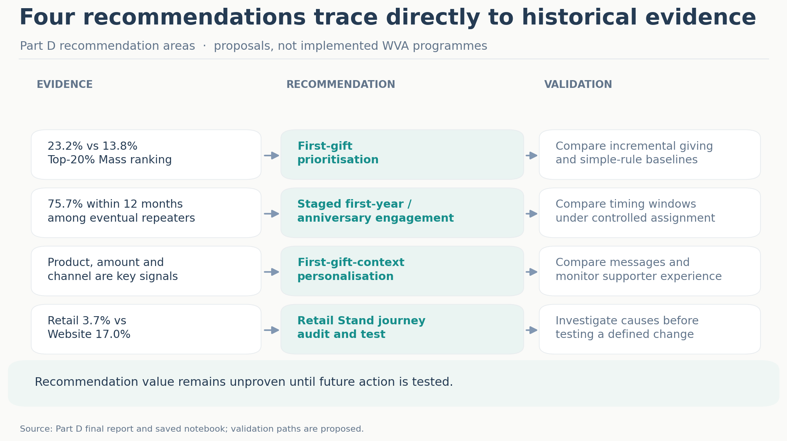
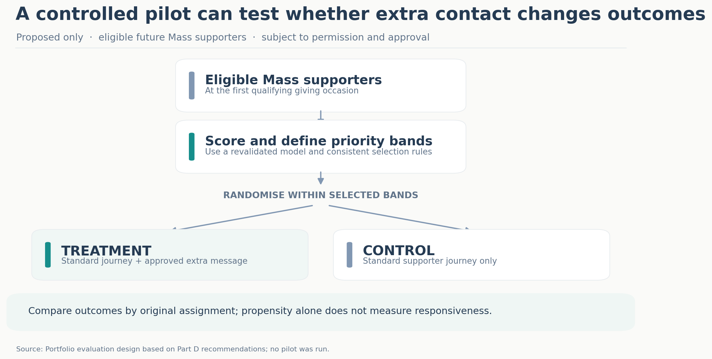
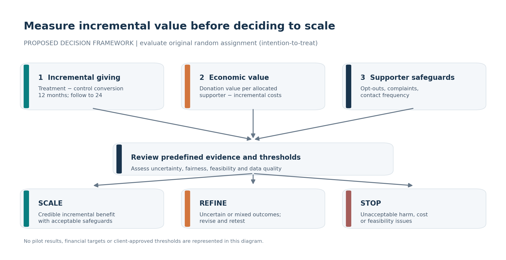

# 05 — Recommendations, Pilot & Business Value

> **Decision question:** How could World Vision Australia (WVA) turn evidence about repeat giving into retention activity that demonstrably creates additional value?

The MIS779 client-based capstone produced historical analysis, model evaluation and evidence-informed recommendations. **No intervention, pilot, client adoption or realised retention uplift has been verified.** This page separates the original recommendations from a **proposed portfolio-level evaluation design**.

## 1. Four opportunities to investigate and test

*Figure 1. Historical evidence mapped to proposed action and measurement. Source: Part D report and saved notebook outputs; actions are proposals.*

| Opportunity | Evidence | Proposed action | What needs to be established |
|---|---|---|---|
| **Prioritise retention attention** | In the **6,741-supporter Mass final-test cohort**, the highest-ranked 20% had a **23.2%** repeat rate versus **13.8%** overall; Lift@20 was **1.68**. | Compare selective additional care with the usual journey, without excluding lower-ranked supporters from standard care. | Whether the extra contact causes incremental repeat giving; whether model ranking adds value over amount-only or product-only rules at equal capacity. |
| **Investigate Retail Stand** | In the separate **19,194-supporter descriptive cohort**, Retail Stand Internal recorded **3.7%** repeat giving versus **17.0%** for Website. Differences appeared within several comparable products. | Map the journey, audit consent and contactability, supporter expectations, onboarding and offline-to-digital follow-up; test a specific correction only after diagnosing friction. | What drives the observed gap, and whether a revised journey improves outcomes. |
| **Personalise first-gift follow-up** | Product, amount and channel differentiated historical repeat behaviour. | Test a simple cause/product-relevant acknowledgement or impact update against existing standard content; use gift value as context, not an exclusion rule. | Incremental conversion and donation value, balanced against opt-outs and contact costs. |
| **Test timing, not a fixed optimum** | **75.7% of the 3,194 eventual repeat donors** returned within 12 months; median time to repeat was approximately **240 days**. | Compare selected first-year or anniversary communication windows with the standard journey. | Whether contact timing changes conversion; historical timing alone cannot answer this. |

**Interpretation:** Propensity describes the chance of repeating under observed conditions, **not** how much additional contact will change that chance. Historical lift is not campaign uplift.

## 2. Move from evidence to a manageable decision

The original Part D recommendations cover ranking, staged first-year/anniversary engagement, first-gift-context personalisation and Retail Stand investigation. The practical sequence below is a **proposed next step**, not an implemented WVA plan:

**Check data and permissions → Audit journey differences → Select one intervention → Compare with standard care → Measure incremental outcomes → Scale, refine or stop.**

For the Retail Stand channel, investigation must come **before** selecting a solution. For prioritisation, the ranking and a simple amount/product rule should first be evaluated at the same contact capacity.

## 3. Proposed controlled pilot: does additional care help?

**Pilot objective:** Establish whether one additional retention message produces incremental repeat one-off giving among future eligible Mass supporters, rather than simply contacting people who would have given again anyway.

*Figure 2. Proposed pilot design, not a completed experiment. Randomisation within a propensity band makes the treatment and control groups more comparable.*

| Design decision | Proposed specification |
|---|---|
| **Population** | Future eligible WVA-classified Mass supporters after their first qualifying giving occasion, subject to confirmed contact permission and existing exclusions. |
| **Stratification** | Score supporters using an appropriately revalidated ranking, then form predefined propensity bands with consistent capacity and tie handling. |
| **Allocation** | Randomise supporters **within each selected band** to treatment and control. Retain the standard journey for everyone. |
| **Treatment** | Standard journey **plus one additional, approved first-gift cause/product-relevant update** through a permitted channel, at a predefined trigger. |
| **Control** | Standard journey only; no additional pilot message. |
| **Primary endpoint** | Another qualifying one-off gift on a later date **within 12 months** of the first occasion. |
| **Extended endpoint** | Continue observing the original **24-month** repeat-giving outcome. |
| **Comparison** | Compare outcomes by **original random assignment**, even if a supporter does not open or engage with the message (intention-to-treat). |

**Design note:** The 12-month primary endpoint is a *new proposed pilot measure*, not a replacement for the historical 24-month model label. The exact trigger, contact channel, eligibility, sample size, measurement plan and operating approvals must be defined before launch. This basic two-arm design tests **additional care within a band**; it does **not on its own establish that model-based selection outperforms simpler prioritisation rules**. That requires a separate equal-capacity comparison or additional randomised design.

## 4. Measure what changes, not just who was predicted to return

| Level | Measure | Question answered |
|---|---|---|
| **Analytical utility** | Lift@20, Capture@20, ranking stability and comparison with simple rules | Does the ranking remain useful for selecting supporters? |
| **Incremental conversion** | Treatment repeat rate **minus** control repeat rate (percentage points), at 12 months and later 24 months | Did additional communication change repeat giving? |
| **Donation value** | Difference in total qualifying donation value **per randomly allocated supporter** | Did assigned treatment improve observed donation value? |
| **Incremental cost** | Added communication, creative, analytical and operational costs | What resources did the intervention consume? |
| **Economic assessment** | Incremental donation value less incremental intervention costs; cost per incremental repeat donor where meaningful | Is there a defensible economic case? |
| **Supporter protection** | Opt-outs, complaints and contact frequency by assigned group | Is the intervention acceptable for supporters? |

**Calculation principle:** `Incremental conversion (pp) = treatment conversion (%) − control conversion (%)`. Compare donation value and costs over **the same allocated population and predefined period**. Donation value is not equivalent to organisational profit.

No financial uplift, ROI, effect size or pilot cost can be estimated credibly from the available historical ranking metrics alone.

## 5. Proposed operational responsibilities

| Function (proposed) | Responsibility / dependency |
|---|---|
| **Fundraising and supporter retention** | Agree intervention purpose, standard-care baseline and acceptable supporter journey. |
| **CRM / marketing operations** | Implement permissions, message trigger, random assignment and contact-frequency controls. |
| **Analytics** | Validate data and ranking, predefine the comparison, preserve treatment assignments and measure outcomes. |
| **Data governance / privacy** | Confirm permitted data use, contact consent, retention and disclosure controls. |
| **Retail Stand / acquisition operations** | Map journey and investigate contact-quality and onboarding issues before a channel-specific test. |
| **Finance** | Identify incremental costs and review the economic interpretation of results. |

These are **suggested functions**, not confirmed WVA assignments or resource commitments.

## 6. Decide whether to scale, refine or stop

*Figure 3. Proposed assessment and decision pathways. Decision thresholds must be agreed before the pilot begins; no client-approved targets are assumed.*

| Decision | Evidence required |
|---|---|
| **Scale cautiously** | Credible incremental conversion or economic value, acceptable supporter outcomes and feasible operations. |
| **Refine and retest** | Uncertain or inconsistent effects, weak targeting performance, data-quality concerns or operational friction. |
| **Stop** | Unacceptable supporter harm, infeasible execution, or costs unjustified by credible incremental benefit. |

Decisions should also consider uncertainty, subgroup differences and whether adequate follow-up has elapsed. A positive historical propensity ranking alone is **not** a scaling criterion.

## 7. Final business conclusion

The project established a consistent **24-month second one-off gift** definition, found meaningful first-gift patterns and demonstrated **retrospective concentration of repeat donors** within a ranked Mass population. These results support a focused programme of investigation and controlled testing—not a claim of proven retention improvement.

**The business opportunity is to learn whether additional, relevant contact generates genuinely incremental giving at acceptable cost while protecting supporter experience.** That remains a question for future, properly governed pilots.

*Evidence and disclosure: Based on MIS779 Part D report and saved notebook results, not a new run against WVA raw extracts. Portfolio-specific pilot and decision frameworks are proposed additions. Publication of client-derived findings remains subject to disclosure permission.*

---

[← Previous: Predictive Modelling & Evaluation](04-predictive-modelling-and-evaluation.md)

[↑ Back to Project Overview](README.md)
