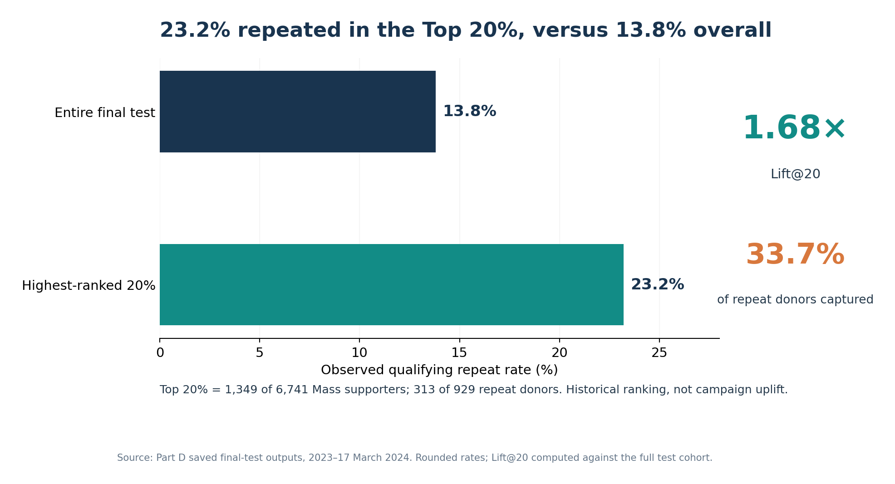

# World Vision Australia — Donor Retention Analytics

**A Deakin University MIS779 client-based capstone | Python | Descriptive and predictive analytics**

**Business question:** Can information available at a supporter's first qualifying one-off gift help World Vision Australia (WVA) understand repeat giving and prioritise retention efforts?

The project examined **another qualifying one-off gift on a later date within 24 months**. It combined six client-supplied data sources, supporter-level preparation, exploratory analysis and retrospective predictive evaluation. The outcome excludes conversion to regular giving; a first *observed* gift is not necessarily the beginning of a supporter's WVA relationship.

## Key findings

| Evidence | What it establishes |
|---|---|
| **16.6% repeated** — 3,194 of 19,194 eligible supporters | Repeat one-off giving was limited in the recent **descriptive cohort**; this is not a measure of all supporter engagement. |
| **Amount alone was insufficient** — 47.4% first gave $50 or less | Product, channel and relationship context warranted further investigation. |
| **ROC-AUC 0.6266** on 6,741 Mass test supporters | The selected Logistic Regression model had **moderate individual-level discrimination**. |
| **Top 20%: 23.2% vs 13.8% overall**; Lift@20 **1.68×**, Capture@20 **33.7%** | The historical ranking concentrated repeat donors in a smaller group; it did **not** demonstrate campaign uplift. |

**Business conclusion:** First-gift product, amount and acquisition channel provided complementary early signals. Prior WVA relationships had descriptive relevance but limited additional predictive importance. Together with the timing of repeat gifts, the results support **testing** retention prioritisation, relevant follow-up and first-year/anniversary contact windows—not claiming these actions have already improved giving.

## Explore the analytical journey

| Stage | Question | Evidence |
|---|---|---|
| [01 · Business Understanding](01-business-understanding.md) | Why does repeat giving matter, and what is in scope? | Business questions, target and decisions |
| [02 · Data Understanding & Preparation](02-data-understanding-and-preparation.md) | How were eligible supporters and outcomes defined? | Sources, checks, cohort rules |
| [03 · Exploratory Analysis & Insights](03-exploratory-analysis-and-insights.md) | What patterns distinguish repeat giving? | Amount, product, channel, relationship, timing |
| [04 · Predictive Modelling & Evaluation](04-predictive-modelling-and-evaluation.md) | Do combined signals improve useful ranking? | H1–H4, validation and Top-K |
| [05 · Recommendations & Business Value](05-recommendations-and-business-value.md) | What could WVA test next? | Integrated interpretation and recommendations |

**Python evidence:** [View the analytical notebook](donor_retention_analysis_review.ipynb). Its code is reviewable, but raw WVA datasets are not distributed and saved outputs were removed; it has **not** been independently rerun from public files.

*The analysis was an academic, client-based project—not employment at WVA. Reported results are historical and recommendations were not verified as implemented. Public use of client-derived material requires appropriate disclosure permission.*
